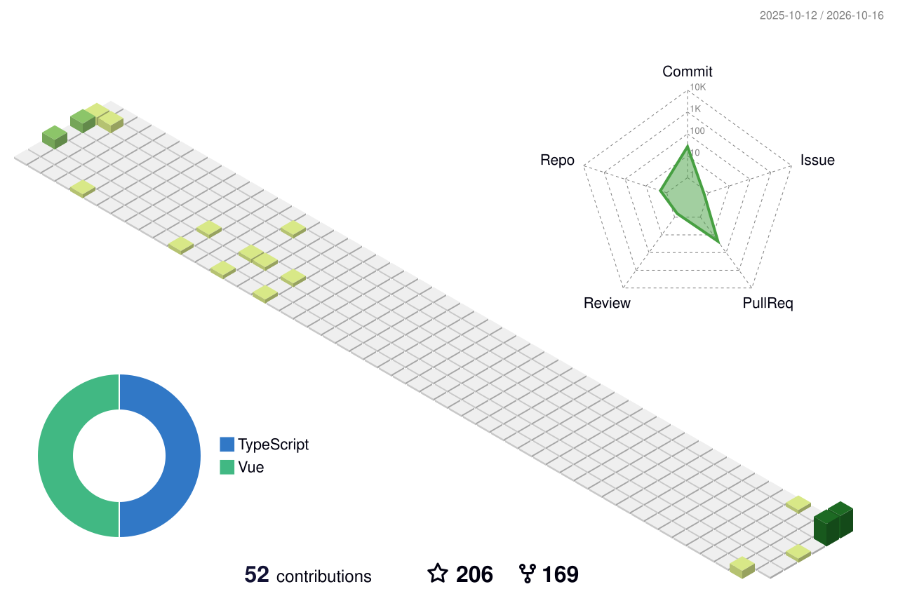

<p>
  
  <p>
    
    
    
    
    
    
    
    
    
    
    <br/>
    
    
    
    
    
    
    
    
    
    
    
    
  </p>
</p>
<p>
  📣 Besoin de me contacter ? Retrouvez-moi ici :<br/>
  <a href="mailto:contact@daniels-roth-stan.fr?subject=[GitHub]%20🔥%20Prise%20de%20contact&body=Bonjour%20Stan%2C%0A%0AJe%20viens%20vers%20toi%20aujourd%27hui%20apr%C3%A8s%20avoir%20vu%20ton%20profil%20GitHub%20pour%20..."></a>
  <a href="https://instagram.com/mrstandu33"></a>
  <a href="https://twitch.tv/mrstandu33"></a>
  <a href="https://linkedin.com/in/stan-daniels-roth-278478127"></a>
  <a href="https://twitter.com/mrstandu33"></a>
</p>
<p>
  🎶Now playing ...🎶<br/>
  <a href="http://spotify-informer.daniels-roth-stan.fr/">
    
  </a><br/>
  <a href="https://github.com/MrStanDu33/spotify-informer"></a><br/>
</p>


<h3>⚡️ Partenaire de vos projets ⚡️</h3><br/>
<p>
  🧔 Moi c'est <bold>Stan</bold>. 25 ans, barbu et un amateur de code et de 🍺.<br/>
  💼 J'habite à <a href="https://www.google.com/maps?q=bordeaux">Bordeaux</a>, en France.<br/>
  💻 Développeur Web <bold>T-Shaped</bold><em>(<a href="https://letslearnabout.net/blog/what-it-is-a-t-shaped-developer-and-why-you-should-be-one">?</a>)</em> <bold><a href="https://vuejs.org">Vue.js</a></bold> × <bold><a href="https://laravel.com">Laravel</a></bold>.<br/>
  🎥 Je fais de temps en temps des lives sur <a href="https://twitch.tv/mrstandu33">Twitch</a>, vous pourrez me voir développer des projets Open Source. <br/>
  🎓 Mentor sur la plateforme <a href="https://github.com/OpenClassrooms">@OpenClassrooms</a> depuis 6 ans
</p>
<p>
  🔗 Vous souhaitez me contacter ? Alors envoyez-moi un <a href="mailto:contact@daniels-roth-stan.fr?subject=[GitHub]%20🔥%20Prise%20de%20contact&body=Bonjour%20Stan%2C%0A%0AJe%20viens%20vers%20toi%20aujourd%27hui%20apr%C3%A8s%20avoir%20vu%20ton%20profil%20GitHub%20pour%20...">mail</a>, ou passez par mon <a href="https://daniels-roth-stan.fr">site</a> !
</p><br/>



<details>
  <summary>Quelques statistiques ...</summary><br/>

<!--START_SECTION:waka-->


**🐱 My GitHub Data** 

> 📦 2.5 MB Used in GitHub's Storage 
 > 
> 🏆 19 Contributions in the Year 2026
 > 
> 💼 Opted to Hire
 > 
> 📜 42 Public Repositories 
 > 
> 🔑 11 Private Repositories 
 > 
**I'm an Early 🐤** 

```text
🌞 Morning                3489 commits        ██░░░░░░░░░░░░░░░░░░░░░░░   08.20 % 
🌆 Daytime                19904 commits       ████████████░░░░░░░░░░░░░   46.76 % 
🌃 Evening                15239 commits       █████████░░░░░░░░░░░░░░░░   35.80 % 
🌙 Night                  3930 commits        ██░░░░░░░░░░░░░░░░░░░░░░░   09.23 % 
```
📅 **I'm Most Productive on Wednesday** 

```text
Monday                   6553 commits        ████░░░░░░░░░░░░░░░░░░░░░   15.40 % 
Tuesday                  7171 commits        ████░░░░░░░░░░░░░░░░░░░░░   16.85 % 
Wednesday                9166 commits        █████░░░░░░░░░░░░░░░░░░░░   21.54 % 
Thursday                 7265 commits        ████░░░░░░░░░░░░░░░░░░░░░   17.07 % 
Friday                   5881 commits        ███░░░░░░░░░░░░░░░░░░░░░░   13.82 % 
Saturday                 3038 commits        ██░░░░░░░░░░░░░░░░░░░░░░░   07.14 % 
Sunday                   3488 commits        ██░░░░░░░░░░░░░░░░░░░░░░░   08.20 % 
```


📊 **This Week I Spent My Time On** 

```text
🕑︎ Time Zone: Europe/Paris

💬 Programming Languages: 
Vue                      4 hrs 19 mins       ████████░░░░░░░░░░░░░░░░░   30.47 % 
Other                    4 hrs 1 min         ███████░░░░░░░░░░░░░░░░░░   28.42 % 
TypeScript               1 hr 26 mins        ███░░░░░░░░░░░░░░░░░░░░░░   10.12 % 
Bash                     1 hr 4 mins         ██░░░░░░░░░░░░░░░░░░░░░░░   07.58 % 
JSON                     1 hr 2 mins         ██░░░░░░░░░░░░░░░░░░░░░░░   07.31 % 

🔥 Editors: 
GoogleChromeBeta         5 hrs 26 mins       ██████████░░░░░░░░░░░░░░░   38.34 % 
Claude Code              3 hrs 2 mins        █████░░░░░░░░░░░░░░░░░░░░   21.39 % 
Slack                    1 hr 56 mins        ███░░░░░░░░░░░░░░░░░░░░░░   13.73 % 
VS Code                  1 hr 27 mins        ███░░░░░░░░░░░░░░░░░░░░░░   10.24 % 
Figma                    44 mins             █░░░░░░░░░░░░░░░░░░░░░░░░   05.26 % 

💻 Operating System: 
Mac                      14 hrs 11 mins      █████████████████████████   100.00 % 
```

🤖 **AI Coding This Week** 

```text
⏱ AI Coding Time: 4 hrs 2 mins (28.42%)

✍️ 613 lines written by AI, 34 lines written by hand (94.74% AI-written)

🔤 8,191,765 Input Tokens, 325,734 Output Tokens

💵 $88.11 Estimated AI Cost This Week

🧠 8 AI Sessions, 77 AI Prompts

Opus                     424 lines           █████████████████░░░░░░░░   68.50 % 
Sonnet                   195 lines           ████████░░░░░░░░░░░░░░░░░   31.50 % 
Claude-Code              0 lines             ░░░░░░░░░░░░░░░░░░░░░░░░░   00.00 % 

🔎 AI Coding Insights:
🤖 AI-Driven — 94.74% of written lines came from AI
📝 Concise Prompter — average 303 characters per prompt
🔁 Iterative Prompter — average 10 prompts per session
🚀 High AI Trust — 15.55% of changed lines were hand-edited
```

**I Mostly Code in JavaScript** 

```text
JavaScript               11 repos            ███████░░░░░░░░░░░░░░░░░░   27.50 % 
PHP                      10 repos            ██████░░░░░░░░░░░░░░░░░░░   25.00 % 
HTML                     8 repos             █████░░░░░░░░░░░░░░░░░░░░   20.00 % 
Vue                      6 repos             ████░░░░░░░░░░░░░░░░░░░░░   15.00 % 
TypeScript               1 repo              █░░░░░░░░░░░░░░░░░░░░░░░░   02.50 % 
```


 Last Updated on 11/10/2026 00:11:31 UTC
<!--END_SECTION:waka-->
</details>
